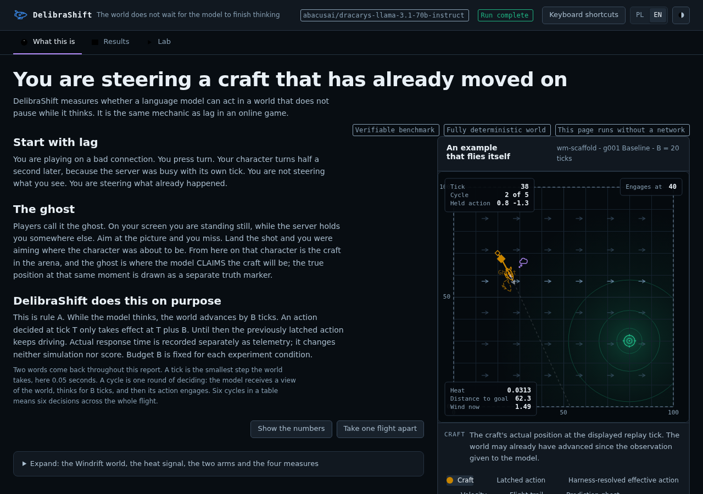

# DelibraShift

**The world moves while agents think.**

A reproducible evaluation harness for testing how agents compensate for
decision delay. In Windrift, a small world with gravity, wind and steering,
the previous action remains active while a fixed **simulated** deliberation
budget elapses. Host response time is recorded separately and never affects
the simulation or score.

Python · deterministic simulation · agent evaluation · offline visualization

[Quickstart](#try-it-without-a-model-account) ·
[Engineering case study](docs/engineering-case-study.md) ·
[Published results](#official-m2-result) ·
[Deutsch / CV](docs/portfolio-summary-de.md)



*Actual report built from the published M2 data. The interactive version runs
locally after the [build below](#try-it-without-a-model-account); this image
is a static preview.*

## A one-minute project review

The engineering question is simple: does an extra prediction stage help an
agent act on the state it will encounter after its decision delay?
DelibraShift supplies the simulator, experiment harness, canonical logs,
scoring, and a bilingual report needed to inspect the answer.

| What the project demonstrates | Evidence to inspect |
|---|---|
| Deterministic state transitions and explicit timing semantics | [World](delibrashift/world.py), [clock](delibrashift/clock.py), [specification](SPEC.md) |
| Matched experiments with shared pacing, seeds and alternating arm order | [Experiment runner](delibrashift/experiments.py), [tests](tests/test_experiments.py) |
| Strict input validation and verifiable artifacts | [Pack loader](delibrashift/bank.py), [archive tools](delibrashift/archive.py) |
| Replayable results and checks against independent calculations | [84 canonical logs](results/m2), [independent audit](report/tests/audit_truth.py) |
| Packaging and browser verification | [CI workflow](.github/workflows/ci.yml), [report tests](report/README.md) |
| Reporting failures as well as improvements | [Official result](#official-m2-result), [limitations](LIMITATIONS.md) |

**Project origin and direction:** Eryk Wyrębek defined the goal, constraints
and priorities, coordinated AI-assisted work, and approved experiments and
publication. Architecture, implementation and review used AI assistance;
the [contribution record](MODEL_CONTRIBUTIONS.md) identifies those roles.

## How the experiment works

```text
Observation → agent prediction and action
            → world advances for a fixed budget under the previous action
            → new action engages → score and canonical JSONL log
```

The prediction target is the world state when the new action engages.
The harness owns prompting, parsing, retries and pacing; model adapters
only provide transport. This separation lets the same model run under a
single-stage END2END prompt or a two-stage WM-SCAFFOLD condition.

Prediction quality, valid-output coverage, temporal anticipation and outcome
are separate measurements. Better JSON parsing does not by itself establish
better control. See the [engineering case study](docs/engineering-case-study.md)
for the design choices and evidence boundaries.

## Try it without a model account

Use Python 3.10+ from the repository root. These shell commands create an
isolated environment and run a deterministic baseline; no API key is needed.
Installing development dependencies requires package downloads.

```bash
python3 -m venv .venv
source .venv/bin/activate
python3 -m pip install -e '.[dev]'
delibrashift-demo --agent random --log episode.jsonl
```

Use `--agent greedy` or `--agent noop` to compare local baselines.
For the interactive report, also install Node.js 22, then run:

```bash
python report/build_report.py --lang en
```

Open `report/delibrashift_report.html` locally. The generated file contains
the published data and works without a server, CDN or network connection.
Switch between English and Polish; use the Lab tab to inspect the held
action, prediction ghost and actual state tick by tick.
The [report guide](report/README.md) explains building and verification.

## Official M2 result

The published experiment evaluates
`abacusai/dracarys-llama-3.1-70b-instruct` under matched END2END and
WM-SCAFFOLD conditions. **The scaffold improved output reliability but reduced
mean outcome.** This is a result for one model, one world and three
repetitions, not a general model ranking.

`core_v0` v0.1.1, R=3, Linux x86_64. Ranges are episode minima/maxima; Δ is the
mean same-scenario, same-repetition WM-SCAFFOLD minus END2END difference.

| metric | END2END mean [range] | WM-SCAFFOLD mean [range] | paired Δ |
|---|---:|---:|---:|
| prediction fidelity | 0.116 [0.058, 0.187], n=10 | 0.129 [0.052, 0.253], n=18 | +0.018, n=4 |
| prediction coverage | 0.585 [0.200, 1.000], n=30 | 0.875 [0.250, 1.000], n=30 | +0.290 |
| temporal anticipation | 0.512 [0.485, 0.566], n=21 | 0.473 [0.429, 0.494], n=21 | **−0.039** |
| outcome | 0.169 [0.005, 0.951], n=30 | 0.090 [0.005, 0.312], n=30 | **−0.079** |
| action parse rate | 0.616 [0.200, 0.857], n=30 | 1.000 [1.000, 1.000], n=30 | +0.384 |
| retried-cycle rate | 0.636 [0.357, 0.833], n=30 | 0.190 [0.000, 0.800], n=30 | −0.446 |
| feedback-use | 0.500, n=9 pairs | 0.500, n=9 pairs | 0.000 |

The scaffold improved structured-output reliability and prediction coverage,
but reduced temporal anticipation on every one of 21 paired visible cells and
reduced mean outcome. Across the 18 matched heat pairs, both arms produced
identical harness-resolved effective actions (accepted parses or no-op
fallbacks) and zero mean outcome effect under the signal swap. Predictions
differed in every pair and parse/retry paths differed in 7 pairs, so the
finding is limited to control and outcome; it is not a claim about the whole
reply or internal model processing. Outcome effects were mixed across cells:
WM-SCAFFOLD was higher in 16/30, lower in 11/30, and tied in 3/30; the reported
`−0.079` is a mean effect, not a universal loss. The negative mean architecture
result is published unchanged.

The complete canonical report and 84 logs are in [`results/m2`](results/m2).
Report SHA-256:
`5ed6e76793684c9c7ef996ae58168ec57301afbcc615f4967c533e853f2506fa`.

## Reproducibility and verification

Physics is a pure function of scenario, state, held action and simulated time
delta. Same-seed local baselines produce byte-identical logs on the same host.
CPython 3.10 on Linux x86_64 is the exact golden-fixture reference;
other supported runtimes enforce the narrow bound in [SPEC.md](SPEC.md).
External inference may vary even with temperature zero and a seed.

```bash
python -m coverage run -m pytest
python -m coverage report
delibrashift-gates packs/core_v0
```

[CI](https://github.com/erykaitools-beep/DelibraShift/actions/workflows/ci.yml)
tests Python 3.10 and 3.12, enforces an 85% combined statement/branch coverage
threshold on the reference runtime, checks the source distribution and installed wheel,
and builds and exercises the report in Chromium. These checks do not call
external models. The independent report audit recalculates physics, outcome,
parse rate and coverage; it does not independently recalculate every metric.

[Baseline references, model adapters and new experiments](docs/running-experiments.md)
are documented separately. Verifying the published result does not require
running a new external experiment.

## Limits and project status

- One deterministic two-dimensional world; no claim of general intelligence,
  robotics readiness or real-time control.
- One model and three repetitions in M2; the reported ranges are episode
  minima/maxima, not confidence intervals.
- The delay is a simulation condition, not measured inference latency.
- The desktop application is separate preview work and is not delivered by
  the public `main` quickstart.
- Exploratory Ollama and Codex conditions are separate from the frozen M2
  result; their transport settings do not establish a comparable leaderboard.

See [LIMITATIONS.md](LIMITATIONS.md) for the full interpretation boundary.

## How Codex and GPT-5.6 were used

OpenAI Codex served as the primary builder and integration agent under human direction.
The operator-facing label was GPT-5.6, with project role
**CODEX 5.6-SOL, Chief Builder**; the exact backend snapshot is not inferred
from that label. The historical build-session ID is
`019f5c9b-5d49-7560-a73f-99cd95665e04`.

Codex assisted with implementation, experiments, integration, validation and
publication. FABLE 5 and Opus 4.8 contributed scientific architecture and
visualization. [MODEL_CONTRIBUTIONS.md](MODEL_CONTRIBUTIONS.md) preserves the
role ledger; [DECISIONS.md](DECISIONS.md) and Git preserve the engineering record.

## Documentation and related work

- [Engineering case study](docs/engineering-case-study.md) and
  [German portfolio/CV text](docs/portfolio-summary-de.md).
- [Specification](SPEC.md), [decisions](DECISIONS.md),
  [milestone history](STATUS.md) and [contributing](CONTRIBUTING.md).
- [Judge verification path](JUDGES.md), [Build Week record](BUILD_WEEK.md),
  [video renderer](video/README.md) and [citation metadata](CITATION.cff).
- [Security](SECURITY.md) and [code of conduct](CODE_OF_CONDUCT.md).
- Related projects: [M.A.R.I.A.](https://github.com/erykaitools-beep/Maria)
  for long-running agent operation and
  [Kritaqo](https://github.com/erykaitools-beep/kritaqo) for a desktop AI workspace.

## License

Copyright © 2026 Eryk Wyrębek. Released under the [MIT License](LICENSE).
